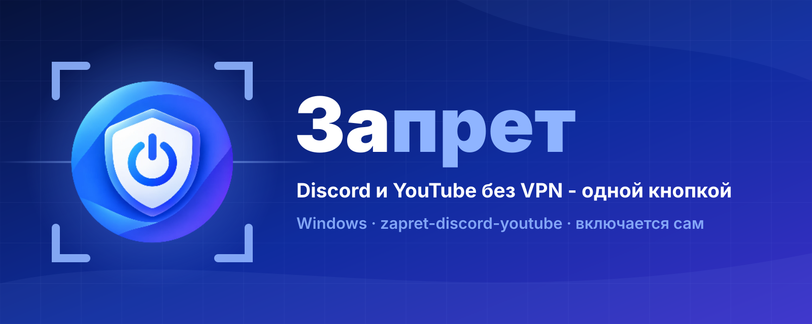
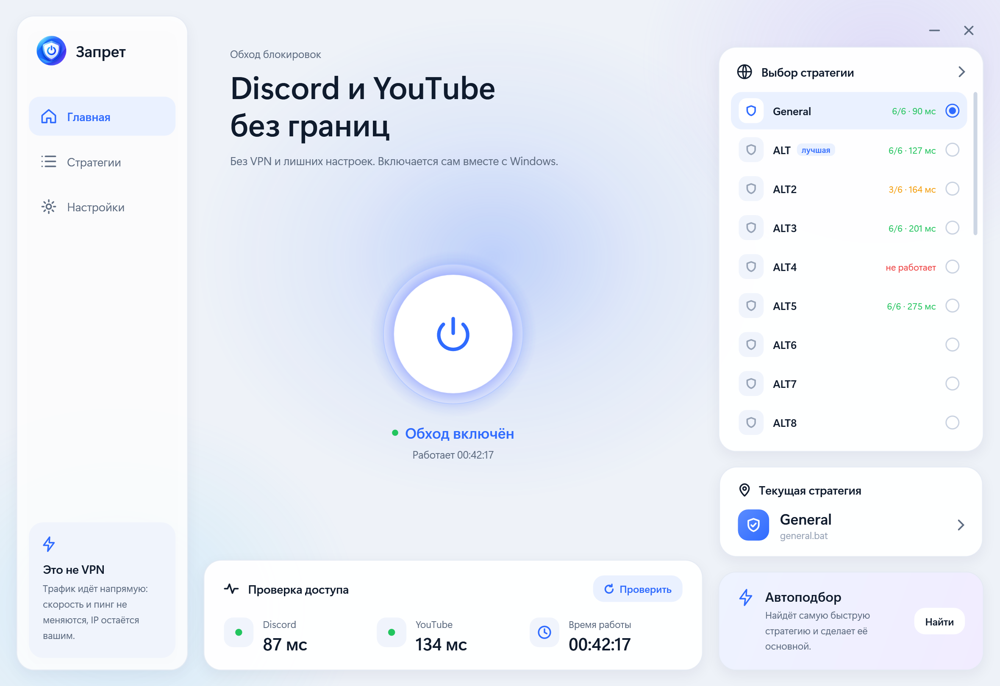
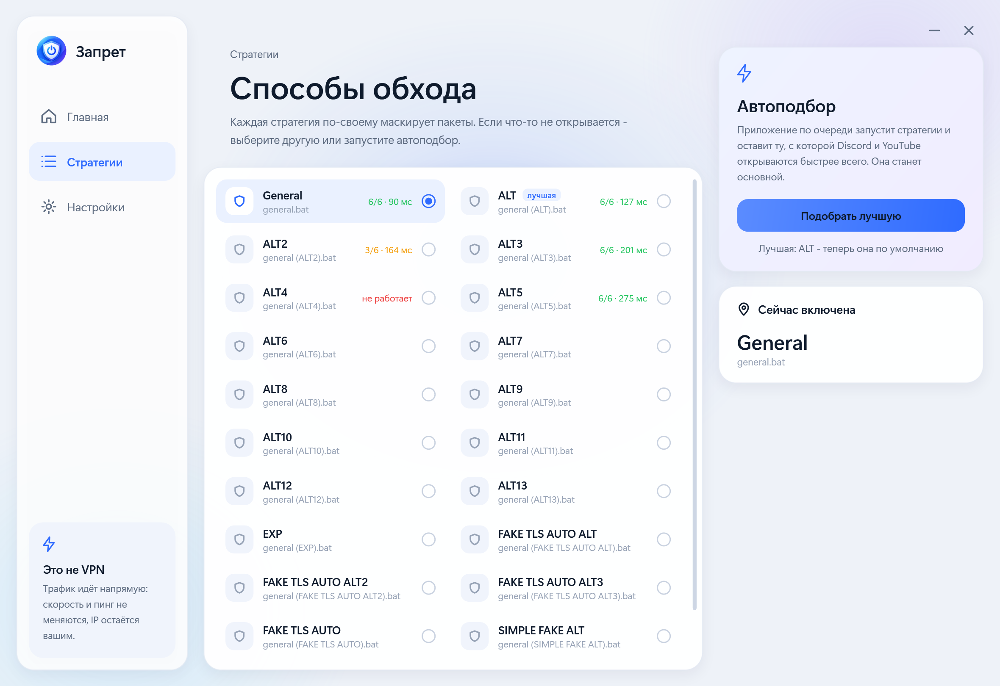

<div align="center">



<br><br>

**Discord и YouTube снова работают. Без VPN, без консоли, без `.bat`-файлов - одной кнопкой.**

<br>

[](#-о-проекте)
[](#-установка)
[](#-технологии)
[](#-технологии)
[](https://github.com/Flowseal/zapret-discord-youtube)
[](#-для-разработчиков)

<br>

[**О проекте**](#-о-проекте) &nbsp;·&nbsp;
[**Как работает**](#-как-это-работает) &nbsp;·&nbsp;
[**Установка**](#-установка) &nbsp;·&nbsp;
[**Если не работает**](#-если-не-работает) &nbsp;·&nbsp;
[**Технологии**](#-технологии) &nbsp;·&nbsp;
[**Для разработчиков**](#-для-разработчиков)

</div>

<br>

> [!NOTE]
> Включил один раз - и забыл. Обход живёт службой Windows и поднимается сам при каждом старте компьютера, даже если приложение не открывали.

<br>

## 🌱 О проекте

**Запрет** - приложение для Windows поверх [zapret-discord-youtube](https://github.com/Flowseal/zapret-discord-youtube) от Flowseal. Внутри та же проверенная технология обхода блокировок, только вместо консольного меню `service.bat` и двух десятков `.bat`-файлов - нормальное окно: большая кнопка питания, список стратегий с пингом, автоподбор и проверка Discord и YouTube.

<table>
<tr>
<td width="50%" valign="top">

### 😞 Как было

- Скачать архив, распаковать, найти «тот самый» `.bat`
- Перебирать 22 стратегии вручную, пока что-то заработает
- После перезагрузки - всё заново, как с VPN
- Непонятно, работает ли сейчас обход вообще

</td>
<td width="50%" valign="top">

### 😊 Как стало

- Запустил `Zapret.exe` - обход уже включён
- Автоподбор сам находит самую быструю стратегию
- Включается вместе с Windows, без участия пользователя
- На главном экране видно: Discord и YouTube открываются, пинг такой-то

</td>
</tr>
</table>

<br>

<div align="center">

</div>

<br>

## 🔍 Как это работает

<table>
<tr>
<td align="center" width="25%">
<h3>🔌</h3>
<b>1. Одна кнопка</b><br>
Нажал - обход включился. Дальше кнопку трогать не нужно
</td>
<td align="center" width="25%">
<h3>🛡</h3>
<b>2. Служба Windows</b><br>
winws работает в фоне и стартует вместе с компьютером
</td>
<td align="center" width="25%">
<h3>⚡</h3>
<b>3. Автоподбор</b><br>
Перебирает стратегии и оставляет самую быструю
</td>
<td align="center" width="25%">
<h3>✅</h3>
<b>4. Проверка</b><br>
Показывает, открываются ли Discord и YouTube
</td>
</tr>
</table>


Провайдер узнаёт, на какой сайт вы идёте, по первым пакетам соединения - и обрывает его. `winws` из zapret немного «портит» эти пакеты так, что фильтр провайдера их не распознаёт, а сайт понимает нормально.

**Это не VPN:** трафик идёт напрямую, скорость и пинг почти не меняются, IP остаётся вашим. Работает для сайтов из списков - Discord, YouTube и других.

<br>

## ✨ Возможности

| | |
| :--- | :--- |
| 🔌 **Включён по умолчанию** | Служба `zapret` с автозапуском: после перезагрузки обход уже работает |
| 🧭 **22 стратегии** | Все стратегии из zapret-discord-youtube, переключение одним кликом |
| ⚡ **Автоподбор** | Пробует стратегии по очереди и делает самую быструю основной |
| 📶 **Проверка доступа** | Discord и YouTube: открываются ли и с какой задержкой |
| 🎮 **Игровой фильтр** | Обход и для игр и голоса в Discord (порты 1024-65535) |
| 🌐 **IPSet** | Обход по списку подсетей или для любого IP |
| 🗂 **Значок в трее** | Крестик сворачивает окно, обход продолжает работать |
| 🔒 **Безопасно** | Файлы службы закрыты от записи обычным пользователем и сверяются с архивом по хешу |

<div align="center">

</div>

<br>

## 📥 Установка

1. Откройте **[Releases](../../releases)** и скачайте `Zapret-<версия>-win-x64.zip`.
2. Распакуйте архив в любую папку и запустите **`Zapret.exe`**.
3. Разрешите запуск от имени администратора - без этого Windows не даёт включить обход.

Всё: обход включится сам. Ставить .NET или что-то ещё не нужно - всё уже внутри.

<details>
<summary><b>Что происходит при первом запуске</b></summary>
<br>

- zapret распаковывается в `C:\ProgramData\ZapretApp` - папку без кириллицы и OneDrive, писать в неё могут только администраторы;
- ставится служба Windows `zapret` с автозапуском;
- приложение копирует себя в `C:\Program Files\ZapretApp` и добавляет значок в трее в автозапуск (выключается в настройках).

</details>

<details>
<summary><b>Как удалить</b></summary>
<br>

1. Нажмите кнопку питания - обход выключится, служба `zapret` удалится.
2. В «Настройках» выключите «Запуск с Windows».
3. Закройте приложение через значок в трее → «Выход».
4. Удалите папки `C:\Program Files\ZapretApp` и `C:\ProgramData\ZapretApp`.

</details>

<br>

## 🩹 Если не работает

> [!WARNING]
> **Антивирус ругается или удаляет файлы.** Многие антивирусы (особенно Kaspersky) считают `winws.exe` и драйвер `WinDivert64.sys` «потенциально опасными» - так они реагируют на любые программы обхода блокировок. Добавьте папку `C:\ProgramData\ZapretApp` в исключения антивируса и запустите приложение снова.

- **Discord или YouTube не открываются** - «Стратегии» → «Подобрать лучшую».
- **Включён VPN или другой обход** (GoodbyeDPI, другой zapret) - выключите: они спорят за драйвер WinDivert.
- **Не работают игры или голос в Discord** - включите «Игровой фильтр» в настройках.

<br>

## ⚙️ Технологии

| Слой | Стек |
| :--- | :--- |
| 🖥 Окно |    |
| ⚙️ Логика |    |
| 🛡 Обход | -2f6bff?style=flat-square)  |
| 🧪 Тесты |   |

<br>

## 🛠 Для разработчиков

Нужен [.NET 8 SDK](https://dotnet.microsoft.com/download/dotnet/8.0) и Windows.

```bash
dotnet test tests/Zapret.Core.Tests
```

```bash
dotnet run --project src/Zapret.App
```

Архив для раздела Releases собирает скрипт: прогоняет тесты, собирает автономный `Zapret.exe` и кладёт `dist\Zapret-<версия>-win-x64.zip`.

```bash
powershell -ExecutionPolicy Bypass -File build-release.ps1
```

| Папка | Что внутри |
| :--- | :--- |
| `src/Zapret.Core` | Вся логика: разбор стратегий из `.bat`, служба Windows, автоподбор, проверка доступа, настройки |
| `src/Zapret.App` | Окно на WPF, значок в трее, запуск с правами администратора |
| `src/Zapret.App/Assets/zapret.zip` | Встроенный архив zapret-discord-youtube |
| `tests/Zapret.Core.Tests` | 123 теста, в том числе на настоящих стратегиях из архива |
| `tools/Preview` | Снимки экранов без запуска службы - для проверки дизайна |

<details>
<summary><b>Как вшить новую версию zapret-discord-youtube</b></summary>
<br>

1. Скачайте `.zip` новой версии со [страницы релизов Flowseal](https://github.com/Flowseal/zapret-discord-youtube/releases).
2. Замените им `src/Zapret.App/Assets/zapret.zip`.
3. Поменяйте `Version` в классе `ZapretInstaller` (`src/Zapret.Core/Setup.cs`) на номер новой версии, а `Version` в `src/Zapret.App/Zapret.App.csproj` - на следующую версию приложения.
4. Прогоните тесты и соберите архив.

При следующем запуске приложение само поставит новую версию, перенесёт в неё свои списки сайтов и игровой фильтр, переключит службу и удалит старую.

</details>

<br>

## 🙏 Благодарности

- [**zapret**](https://github.com/bol-van/zapret) - bol-van, сама технология обхода (`winws`)
- [**zapret-discord-youtube**](https://github.com/Flowseal/zapret-discord-youtube) - Flowseal, стратегии и списки для Discord и YouTube
- [**WinDivert**](https://github.com/basil00/WinDivert) - basil00, драйвер перехвата пакетов

Файлы этих проектов распространяются на условиях их собственных лицензий - см. их репозитории.
